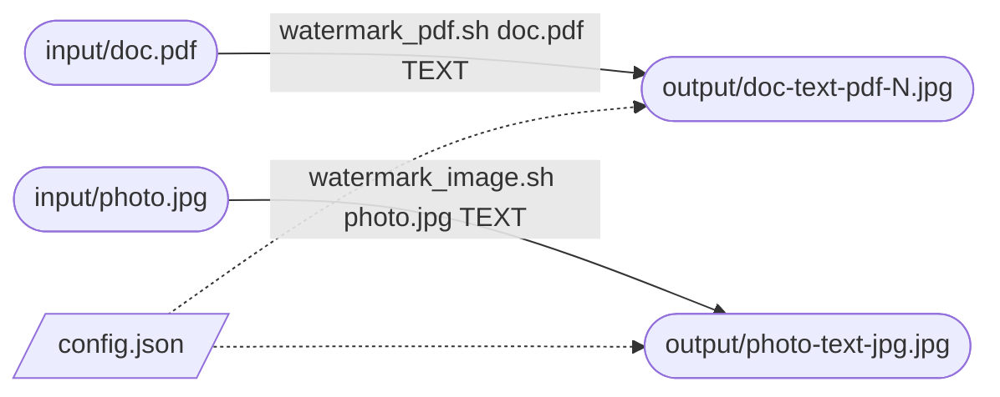

# watermark

Shrink a PDF or an image. Add a faint text watermark. Run it with Docker.



1. [watermark_pdf.sh](./watermark_pdf.sh)
1. [watermark_image.sh](./watermark_image.sh)

Rounded boxes are files. The dotted line is the config read.

## Install

You need [Docker](https://docs.docker.com/get-docker/). Build the image one time:

```sh
docker build -t watermark .
```

## Set up

1. Copy [config.example.json](./config.example.json) to `config.json`. Keep it in this folder.
1. Put the files to convert in the `input/` folder.

```json
{
  "size": 1600,
  "opacity": 0.15,
  "font_size": 0.04
}
```

Git ignores the files in `input/` and `output/`. Git keeps the two folders.

## Watermark an image

```sh
./watermark_image.sh photo.jpg "COPY FOR ACME – 2026"
```

1. The script reads `input/photo.jpg`
1. The second argument is the watermark text
1. The result is `output/photo-copy-for-acme-2026-jpg.jpg`
1. The watermark text repeats across the whole image, at an angle

## Watermark a PDF

```sh
./watermark_pdf.sh doc.pdf "COPY FOR ACME – 2026"
```

1. The script reads `input/doc.pdf`
1. Each page becomes one JPG: `output/doc-copy-for-acme-2026-pdf-1.jpg`, `-2.jpg` and so on
1. A PDF with one page has no page number: `output/doc-copy-for-acme-2026-pdf.jpg`

## Output names

The name has this pattern:

```
<file name>-<watermark text>-<file type>[-<page>].jpg
```

Each part is normalised: lowercase, no accents, and one dash in place of spaces and symbols.

| Input | Watermark | Output |
|---|---|---|
| `Doc One.pdf` (2 pages) | `COPY FOR ACME – 2026` | `doc-one-copy-for-acme-2026-pdf-1.jpg`, `…-2.jpg` |
| `single.pdf` (1 page) | `COPY FOR ACME – 2026` | `single-copy-for-acme-2026-pdf.jpg` |
| `Photo.JPG` | `Café 2026` | `photo-cafe-2026-jpg.jpg` |

An existing output file is overwritten.

## File information

Each watermarked JPG stores the watermark date and text in its metadata:

| Field | Value |
|---|---|
| EXIF `ModifyDate` | Date and time of the run, in UTC |
| XMP `dc:Description` | The exact watermark text, with accents and symbols |
| XMP `xmp:ModifyDate` | Date and time of the run, in UTC |

Read it with [ExifTool](https://exiftool.org):

```sh
exiftool -ModifyDate -Description output/photo-cafe-2026-jpg.jpg
```

The metadata of the original file is not copied. GPS data and camera data stay out of the output.

## Options

The watermark text is an argument of the script. Quote it. It needs at least one letter or digit.

The other options live in `config.json`:

| Key | Required | Default | Meaning |
|---|---|---|---|
| `size` | Yes | — | Maximum long edge, in pixels. The aspect ratio stays the same. |
| `opacity` | No | `0.15` | Text strength. `0.05` is almost invisible. `1` is solid. |
| `font_size` | No | `0.04` | Text height as a fraction of the long edge. `0.08` gives text twice as big. |

### Change the watermark text

Give another text to the script:

```sh
./watermark_image.sh photo.jpg "CONFIDENTIAL"
```

The output name changes with the text: `photo-confidential-jpg.jpg`.

### Make the watermark stronger or weaker

Edit `config.json`:

```json
{ "size": 1600, "opacity": 0.3, "font_size": 0.06 }
```

### Change the output size

`size` is the maximum length of the long edge. The picture keeps its aspect ratio. A smaller picture keeps its size. This applies to images and to PDF pages.

| Input | `size` | Output |
|---|---|---|
| 4000×3000 | 1600 | 1600×1200 |
| 600×800 | 1600 | 1200×1600 |
| 800×600 | 1600 | 800×600 |

### Use more than one config

Keep one file for each use in this folder. Pass the file with `--config`:

```sh
./watermark_image.sh photo.jpg "DRAFT" --config /data/draft.json
```

The path is a path inside the container. This folder is `/data`.

### Fixed values

These values do not change:

1. Text colour: grey
1. Text angle: 30°
1. Font: DejaVu Sans
1. JPG quality: 85

## Good to know

1. The original file never changes
1. Set `WATERMARK_IMAGE` to use another Docker image name. The default is `watermark`
1. The scripts work from any folder

## Without the scripts

The image has two commands. Run them from this folder:

```sh
docker run --rm -v "$PWD:/data:ro" -v "$PWD/output:/data/output" watermark watermark input/doc.pdf --watermark "COPY FOR ACME" --output output
docker run --rm -v "$PWD:/data:ro" -v "$PWD/output:/data/output" watermark pdf2jpg input/doc.pdf --output output
```

| Command | Input | Output |
|---|---|---|
| [watermark](./scripts/watermark.py:166) | PDF or image | Watermarked JPGs. Needs `--watermark`. |
| [pdf2jpg](./scripts/watermark.py:159) | PDF | Resized JPGs with no watermark. Names have no watermark part: `doc-pdf-1.jpg` |

Without `--output`, the files go next to the input file.

## Errors

| Message | Exit code | Fix |
|---|---|---|
| `usage: …` | 64 | Give the file name and the watermark text. |
| `not found: input/NAME` | 66 | Put the file in `input/`. Check the name. |
| `config error:` | 2 | Fix `config.json`. The message names the bad key. |
| `error:` | 1 | Check that the file is a valid PDF or image. |
| `argument --watermark:` | 2 | Use a text with at least one letter or digit. |

## Privacy

All data stays on your computer.

1. The tool makes no network calls when it runs
1. The tool sends no data, no usage data and no logs
1. Your files stay in `input/` and `output/`. The container mounts `input/` read-only.
1. Only `docker build` uses the internet. It downloads software packages. It does not send your files.

To check, add `--network none` to the `docker run` line. The tool still works.

## About

| Item | Value |
|---|---|
| Needs | Docker |
| Input | PDF, and image formats that Pillow reads (eg JPG, PNG) |
| Output | JPG |
| Built with | Python 3.12, Pillow 13.0.0, pypdfium2 5.14.0 |
| Container user | Non-root |

## License

MIT. See [LICENSE](./LICENSE).
