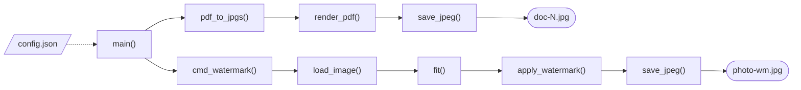

# watermark

Docker image with two commands. Both write JPG files.

| Command | Input | Output |
|---|---|---|
| `pdf2jpg` | PDF | One `name-N.jpg` per page |
| `watermark` | Image (eg JPG, PNG) | `name-wm.jpg` |

Both commands shrink the image to `size` from `config.json`. `watermark` also adds a faint text pattern.

## Build

```sh
docker build -t watermark .
```

## Use

Put `config.json` and the input file in one folder. Run the command from that folder.

```sh
docker run --rm -v "$PWD:/data" watermark pdf2jpg doc.pdf
docker run --rm -v "$PWD:/data" watermark watermark photo.jpg
```

1. `pdf2jpg doc.pdf` writes `doc-1.jpg`, `doc-2.jpg` and so on
1. `watermark photo.jpg` writes `photo-wm.jpg`
1. Add `--config path/to/file.json` to use another config file. The default is `/data/config.json`

On Linux, add `--user "$(id -u):$(id -g)"`. The output files then belong to you.

## Config

Copy [config.example.json](./config.example.json) to `config.json`.

| Key | Type | Default | Meaning |
|---|---|---|---|
| `size` | integer | required | Maximum long edge, in pixels |
| `watermark` | string | required for `watermark` | Text of the pattern |
| `opacity` | number, above 0 and up to 1 | `0.15` | Text opacity |
| `font_size` | number, above 0 and up to 1 | `0.04` | Text height, as a fraction of the long edge |

## Behaviour

1. The aspect ratio stays the same
1. An image smaller than `size` keeps its size. Nothing gets bigger
1. Output goes next to the input. The input stays unchanged
1. An existing output file is overwritten
1. JPG quality is 85
1. `watermark` draws grey text. The text repeats at 30° across the full image

Exit codes:

| Code | Meaning |
|---|---|
| 0 | Success |
| 1 | Input file missing or unreadable |
| 2 | Config file missing or invalid |

## Flow



1. [main()](./wm.py:161): reads the config. Runs the chosen command
1. [pdf_to_jpgs()](./wm.py:91): the `pdf2jpg` command
1. [render_pdf()](./wm.py:79): renders each page. Calls `fit()` on it
1. [cmd_watermark()](./wm.py:135): the `watermark` command
1. [load_image()](./wm.py:74): opens the image. Applies the EXIF (Exchangeable Image File Format) rotation
1. [fit()](./wm.py:64): shrinks the long edge to `size`
1. [apply_watermark()](./wm.py:116): draws the tiled text on the image
1. [save_jpeg()](./wm.py:70): writes the JPG

The dotted line is the config read. Solid lines are calls.

## License

MIT. See [LICENSE](./LICENSE).
